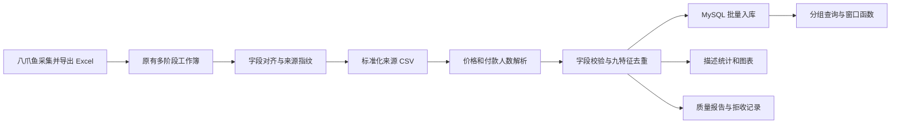
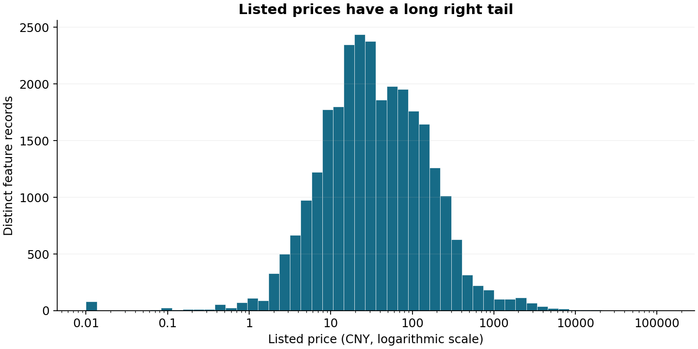
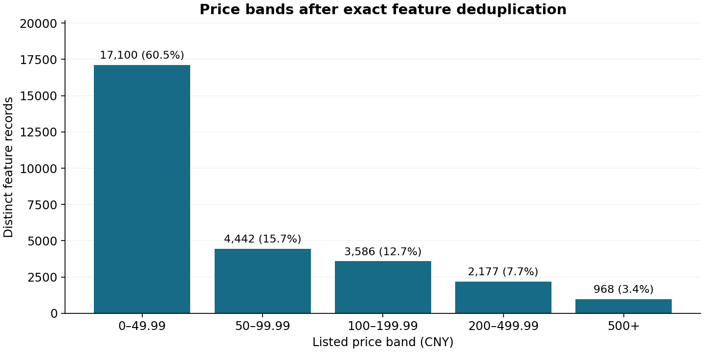
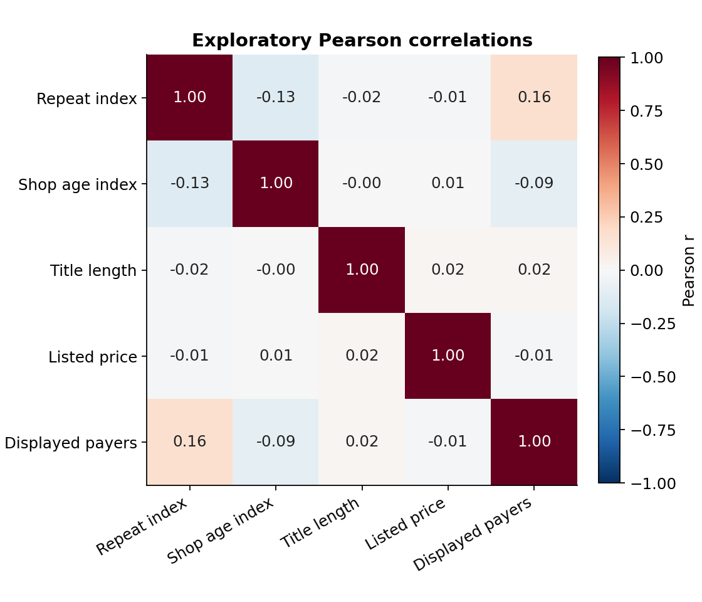

# E-commerce MySQL ETL & Analysis

**电商商品采集、清洗与 MySQL 分析实践**。围绕银发消费相关搜索主题，使用八爪鱼采集商品页面数据，完成字段转换、特征整理、MySQL 存储和探索性分析。本仓库将已有课程实践材料整理成可复现的 Python / SQL 项目。

作者：谢宇辉。数据采集、清洗、数据库和分析工作由作者完成，实际采集工具为**八爪鱼（Octoparse）**。2026 年 10 月的仓库工程化整理使用了 AI 编程辅助；历史材料与新增实现的边界见 [项目演进](docs/project-notes.md)。

## 核验后的数据规模

| 项目 | 结果 | 统计含义 |
| --- | ---: | --- |
| 输入观察记录 | 28,722 | 所提供各阶段工作簿的行记录，不等于已验证唯一商品数 |
| 搜索关键词 | 572 | 不直接等同于标准商品类目 |
| 不同商品标题 | 23,875 | 标题相同不代表同一个商品 |
| 九个特征完全相同的冗余行 | 449 | 保留在来源数据中，并计入出现次数 |
| 去重后特征记录 | 28,273 | 九字段哈希对应的一条特征记录 |
| 付款人数含 `+` 的来源记录 | 21,833 | 转换值是页面展示下界，保留相应标记 |
| 重算特征与最终工作簿的差异 | 0 | 逐行比较九个字段；不代表所有原始标签的业务含义已验证 |

完整证据：[来源清单](data/source/source_manifest.json)、[清洗质量报告](reports/run/quality_report.json)、[分析结果](reports/analysis/summary.json)。

## 流程与能力



| 环节 | 实现 | 可查看内容 |
| --- | --- | --- |
| 数据采集 | 八爪鱼可视化采集，导出商品与店铺相关字段 | [采集与导出说明](docs/collection.md) |
| 版本对齐 | 对齐五份工作簿，记录文件哈希，检查标题与特征一致性 | `scripts/prepare_sources.py` |
| 清洗加工 | 价格 Decimal 解析、万/亿单位转换、`+` 下界标记、文本长度计算和数值约束 | `ecommerce/cleaning.py` |
| 数据质量 | 精确特征去重、保留出现次数、异常拒收、输入输出指纹及参考列对照 | `ecommerce/pipeline.py` |
| MySQL | utf8mb4、DECIMAL、CHECK、外键、联合主键、索引、事务与参数化批量写入 | `sql/schema.sql`、`ecommerce/mysql_load.py` |
| 分析 | 去重前后统计、价格区间、关键词汇总、相关性与 Top-N SQL | `ecommerce/analysis.py`、`sql/analysis.sql` |

## 运行

建议 Python 3.12；数据库使用 MySQL 8.0.16+。离线处理与统计不需要数据库。

```powershell
python -m venv .venv
.venv\Scripts\Activate.ps1
python -m pip install -r requirements-dev.txt
python -m ecommerce.pipeline
python -m ecommerce.analysis --input artifacts/run/products.csv --output artifacts/analysis
python scripts/plot_analysis.py --input artifacts/run/products.csv --output artifacts/figures
```

macOS / Linux 使用 `source .venv/bin/activate`。仓库已包含标准化来源 CSV，可直接复现处理结果，无需联网采集或取得原始工作簿。

默认处理结果在 `artifacts/run/`：

- `products.csv`：去重后特征、下界标记、出现次数与首次来源行号。
- `quality_report.json`：观察记录数、拒收分类、对照差异与文件哈希。
- `rejected.csv`：异常行位置和拒收原因。

同一输出目录再次运行会更新结果。保留多个版本时使用不同 `--output` 路径。

### MySQL 入库与查询

先在自己的 MySQL 中准备项目数据库：

```sql
CREATE DATABASE IF NOT EXISTS ecommerce_portfolio
  CHARACTER SET utf8mb4 COLLATE utf8mb4_unicode_ci;
```

复制 `.env.example` 为 `.env`，填写实际本地账号、密码和端口；该账号需有本项目数据库内的建表、索引、外键及读写权限。

```powershell
python -m ecommerce.mysql_load --input artifacts/run/products.csv --report artifacts/run/quality_report.json
```

随后在数据库客户端中选择 `ecommerce_portfolio` 并执行 `sql/analysis.sql`。文件展示总体统计、关键词汇总、分组 Top-3、价格区间与重复观察明细；多批次时应显式指定所分析的批次哈希。

入库脚本验证 CSV 与质量报告的哈希和计数，再用事务执行参数化 `executemany`。相同批次重复导入覆盖原有出现次数，保持记录数稳定；不使用逐次累加的重复计数，也不需要修改全局 `LOCAL INFILE` 配置。

### 检查

```powershell
python -m pytest -q
```

默认执行离线检查；设置 `MYSQL_TEST_PORT` 后，数据库集成检查会连接专用的 `ecommerce_test` 测试库。GitHub Actions 自动启动独立的 MySQL 8.0 服务完成全量入库与查询检查。

本地已在临时 MySQL 8.0.43 中完成全量入库、同批次导入两次和分析 SQL 运行，见 [数据库核验记录](reports/mysql_verification.json)。该检查使用专用临时实例，不使用已有数据库服务。

## 分析展示



去重后标价中位数为 **32.00 元**，均值约 **134.41 元**；高价长尾明显。保留高价观察并展示分布，不凭阈值将真实高价商品直接认定为错误。



九字段去重后，标价低于 50 元的特征记录占约 **60.5%**。这是观察样本中的标价分布，不等于消费者价格偏好。



价格与页面展示付款人数的 Pearson 相关系数约 **-0.0122**，在该样本中线性相关很弱。它不能证明价格对购买没有影响，也不能推断不存在其他非线性关系。

## 字段解释与边界

`付款人数` 是页面展示计数，有些取值带 `+`；记录没有统一时间窗口、订单明细或用户去重标识，不能计算真实 GMV、订单销量或独立消费者数量。商品面向银发消费主题，也不能证明购买者就是老年人。

回头客指数、老店指数、地区标签和评价标签保留已有工作簿编码；这些标签的原始定义与标注依据未完整提供。例如，老店指数为 0 可能表示未显示标签，不能直接认定是新店；评价标签为 1 不能直接解释为优质好评。详见 [数据字典](docs/data-dictionary.md)。

提供的工作簿是处理中间版本，缺少最初采集的全部字段及产品 ID / 采集时间。仓库从这些可核验的版本开始复现，不宣称重新执行过历史网页采集。报告中的扩展模型与业务结论仅作为参考，当前可运行分析以代码和 CSV 为准。

## 项目材料

- [项目演进与材料核验](docs/project-notes.md)
- [采集与 Excel 导出流程](docs/collection.md)
- [字段字典与统计口径](docs/data-dictionary.md)
- [简历表述与项目讲解](docs/resume-and-interview.md)

这个项目用于展示数据获取、清洗、关系型存储和分析基础，可与 AI 伴侣项目共同支撑 AI 数据工程方向的作品集。
